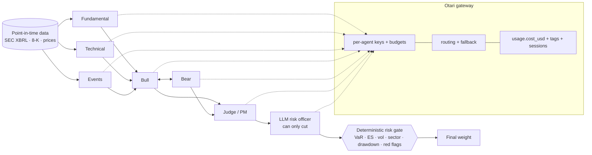

# AI Investment Committee on Otari

A multi-agent committee that makes weekly long-only decisions on US large caps, with every model
call going through [Otari](https://github.com/mozilla-ai/otari). The question it answers is
practical: **what does each agent cost, and is it worth it?**

Every model call, page fetch and sandbox run goes through Otari. The main profile (`open`)
uses **only open-weight models, from four labs, one per job**:

| Seat | Model (fallback) | Why |
|---|---|---|
| Fundamental, technical and events analysts | DeepSeek V4.1 Flash (Qwen 3.8 Flash) | cheap, steady JSON, run 3x in parallel |
| Bull and bear debaters | GLM-5.3 Flash (Mistral Small 4) | a different lab from the analysts, so the debate is not one model arguing with itself |
| Judge / portfolio manager | DeepSeek V4 Pro (Kimi K3 Fast), tiering down to Qwen 3.8 Flash when its budget runs low | the one call that needs the most reasoning |
| Risk officer | Qwen 3.8 Flash (Mistral Small 4) | can only cut size |

A full decision costs about **$0.004** (6 calls, about 9k tokens), as measured from Otari's
inline `usage.cost_usd`.

### Otari features used

| Feature | Where | How you can see it |
|---|---|---|
| Model routing and fallbacks | `profiles.toml` profile `otari` calls the routing policies `committee-analyst`, `committee-debater`, `committee-judge` and `committee-risk`, each with `on_failure` candidates. The client adds a second chain after the gateway's | `Otari-Fallback` and `Otari-Attempt-Count` are logged per call (`attempts`, `fallback` columns) |
| Multiple models serving distinct roles | four open-weight models from four labs, above | ledger `served_model` per role |
| Budgets and spending limits | one virtual key per agent (`OTARI_API_KEY_<ROLE>`), each with its own budget. `GET /key/budget` runs before the judge: below `JUDGE_BUDGET_FLOOR_USD` the judge **tiers down** to the economy model. At the cap, `403 budget_exceeded` makes the decision fail closed | `decision.otari.judge_budget_left_usd`, `judge_tiered_down_to` |
| Per-user budgets | a service key bills each decision to an end user (`user: desk:alice`), each on its own end-user budget. CLI `--user`, or the "Bill to" box in the UI | ledger `end_user` column; Otari End users page |
| Code execution | before any BUY, the risk gate re-computes historical VaR and ES in Otari's sandbox (`POST /code/execute`), with no model involved. A mismatch with the local numbers vetoes the trade | risk check `otari_sandbox_recompute` |
| Web fetch | in live mode the events analyst reads the latest 8-K filing through `POST /fetch` | `decision.otari.web_fetch` |
| Guardrails | the events analyst sees untrusted text (8-K body, headlines), so its request carries a `prompt-injection` guardrail in block mode. A flagged request is dropped and the committee goes on without that view | `Otari-Guardrails` verdicts in the ledger |

Also used: `metadata` tags (role, profile, run, ticker, end user) for spend by agent
(`python -m committee usage`), one `Otari-Conversation-Id` session per decision, and the disk
cache, so a re-run costs $0.

> Research and education only. Not investment advice. Paper trading only.

## How a decision is made



The three analysts run in parallel. If any call fails after a repair attempt and the fallback
chain, the committee **fails closed**: it drops that analyst, or turns the decision into HOLD with
no new risk.

## Quick start

```bash
pip install -r requirements.txt
cp .env.example .env        # add OTARI_API_KEY (otari.ai or your self-hosted gateway)

python -m committee doctor                       # checks the gateway and lists the models it serves
python -m committee analyze NVDA --profile open
python -m committee backtest --profiles rules,open --start 2026-07-01 --end 2026-11-06
streamlit run app.py
python -m pytest -q
```

The `rules` profile needs no key, so you can try the whole pipeline offline first:
`python -m committee backtest --profiles rules`.

### Otari setup

1. Create an account on [otari.ai](https://otari.ai), or self-host with
   `docker run -p 8000:8000 -v otari:/data mzdotai/otari:latest`. In `.env`, set `OTARI_API_KEY`;
   for an EU account, also set `OTARI_BASE_URL=https://eu.api.otari.ai/api/v1`.
2. **Agent budgets.** Create a key per agent with a small budget, for example $2 for the judge.
   Put them in `.env` as `OTARI_API_KEY_<ROLE>`. A role with no key of its own uses `OTARI_API_KEY`.
3. **Routing policies.** Create `committee-analyst`, `committee-debater`, `committee-judge` and
   `committee-risk`, with the defaults and `on_failure` models from the table above. Then use
   `--profile otari`.
4. **Per-user budgets.** Create an end-user budget, for example $0.50 a day. Create a service key that may
   start end users on it, and set `OTARI_SERVICE_KEY`.
5. **Web fetch and guardrails.** Turn on web access for the workspace (Tools > Web search) and set
   `OTARI_WEB_FETCH=1`. If your organization has a guardrails service, set
   `OTARI_GUARDRAIL_PROFILE=prompt-injection`.
6. Run `python -m committee usage` to see spend grouped by the `role` tag, as Otari recorded it.

When a key's budget is exhausted, Otari returns `403 budget_exceeded`. The client moves down the
chain, and the decision fails closed if nothing is left. A runaway agent cannot overspend.

## Avoiding look-ahead bias

LLM backtests usually leak the future. This one closes four leaks:

| Leak | Guard |
|---|---|
| Fundamentals restated or filed later | XBRL facts are filtered on `filed <= as_of`, so a restatement filed after the decision date is invisible (unit-tested) |
| Trading on the close you just saw | Decide on day *t*'s close, trade on *t+1*'s close, and pay 5 bps per unit of turnover |
| The model remembers what happened | Backtest prompts are **anonymized**: no ticker, no company name, no date, and only ratio features. Profiles declare a `knowledge_cutoff`, and the CLI warns when the window starts before it |
| News that wasn't public yet | Historical headlines are not available point in time, so backtests use SEC filings only. Headlines are used only in live mode |

## Reading the results

`runs/<id>/report.md` holds three tables:

- **Performance:** return, volatility, Sharpe, max drawdown and ES97.5.
- **Signal quality:** the cross-sectional rank IC between the committee's signed conviction and next-week excess return over SPY, with its t-stat, and the BUY hit rate.
- **Cost and reliability:** LLM calls, dollars, cost per decision, failed calls, fallbacks, and how many cited input fields don't exist (a hallucination check).

Baseline run with no LLM (`rules`), 12 stocks, weekly, 2026-07-01 to 2026-11-06:

| strategy | total return | Sharpe | max DD | mean IC | BUY hit rate |
|---|---|---|---|---|---|
| SPY buy & hold | -1.29% | -0.20 | -5.92% | – | – |
| Equal-weight universe | 3.86% | 0.87 | -5.20% | – | – |
| committee: rules | -3.35% | -1.30 | -4.94% | -0.03 | 52.3% |

LLM profiles are compared against this row. A few months of weekly decisions is a small sample,
so judge them by the IC t-stat, not by returns.

## Layout

```
committee/
  config.py     Otari settings, per-role keys, profiles, risk limits
  llm.py        Otari client: tags, sessions, schema validation, repair, fallback, cache, ledger
  data.py       yfinance prices, SEC EDGAR facts and filings (point in time, cached)
  features.py   technical, fundamental (TTM from XBRL), event features
  agents.py     schemas, prompts, and the deterministic rules version of each role
  pipeline.py   one committee decision
  risk.py       VaR, ES, beta, the risk gate, portfolio limits
  backtest.py   walk-forward engine, benchmarks, IC
  report.py     markdown report
app.py          Streamlit demo
profiles.toml   model profiles (edit freely)
tests/          offline tests (no network, no keys)
```

## Where this came from

This started as a half-finished course template: a LangGraph multi-agent trading demo that
called OpenAI directly, parsed JSON by hope, and backtested an RSI rule instead of the agents.
It was rebuilt from scratch around Otari:

- per-agent budgets
- routing and fallback
- cost tracking
- point-in-time SEC data
- a deterministic risk layer
- an evaluation that can tell whether the LLMs add anything over a rules baseline
